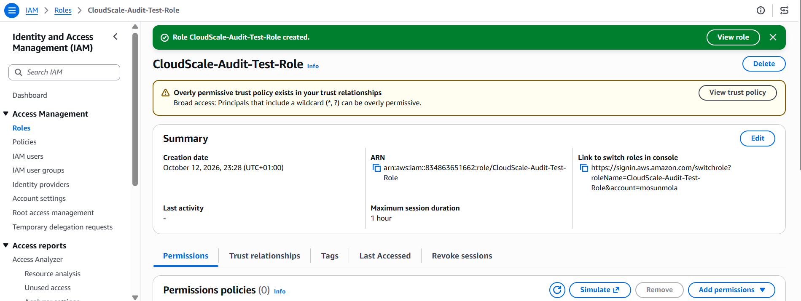
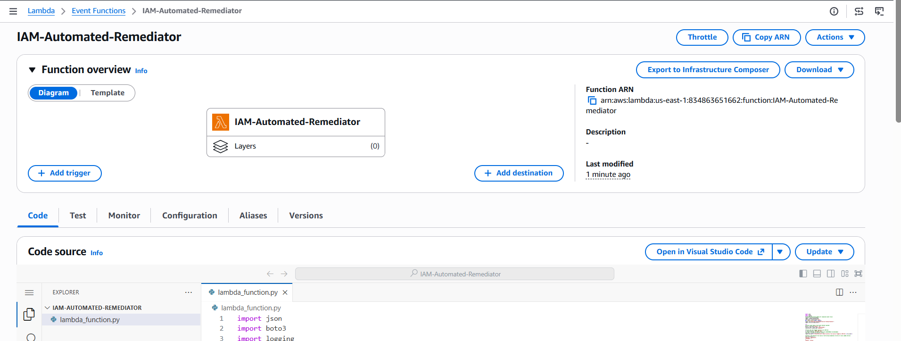
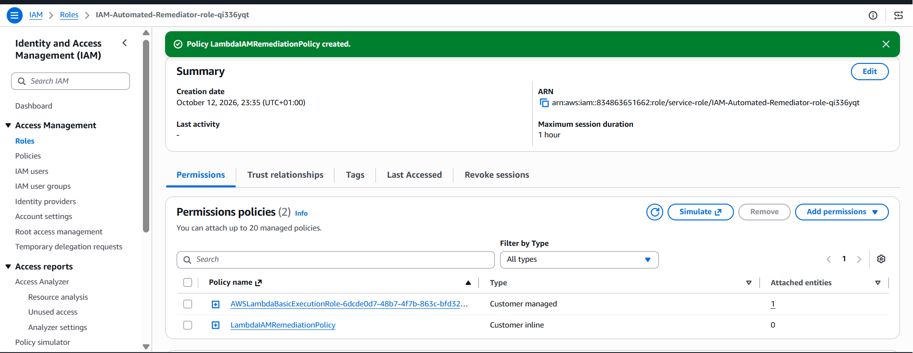
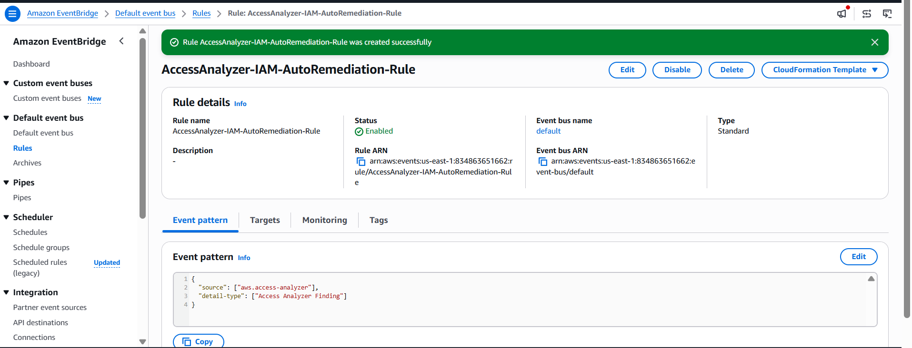
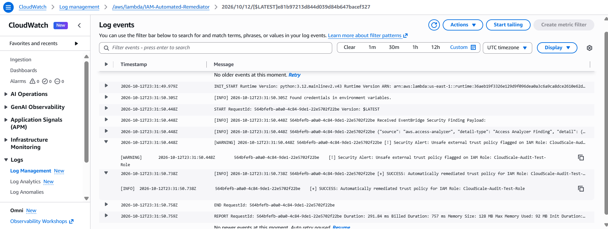

# Autonomous-AWS-IAM-Least-Privilege-Remediation-Engine
This project implements the design, build, and testing of an end-to-end event-driven cloud remediation pipeline for compute resources and IAM roles.

## Core Learning Objective

Design, implement, and test an event-driven AWS security remediation pipeline that detects IAM permission misconfigurations and applies automated remediation to enforce the principle of least privilege.

## Skills Practiced

**AWS IAM Security:** working with IAM roles, policies, permission boundaries, and least-privilege access.

**Event-Driven Architecture:** designing event-driven workflows that trigger remediation in response to security findings.

**Cloud Automation:** developing automated remediation logic to reduce manual intervention in cloud security operations.

**Security Validation**: testing remediation workflows and verifying that corrective actions are applied as intended.

## Tech stack

- AWS IAM Access Analyzer
- Amazon EventBridge
- AWS Lambda
- AWS CloudWatch Logs
- Python (boto3)

## Architecture Flow

```text
IAM Access Analyzer → EventBridge → Lambda → IAM Role
                                      ↓
                                 CloudWatch Logs
```

| Component | Role |
|---|---|
| **IAM Access Analyzer** | Detects any overprivileged IAM roles and generates findings |
| **Amazon EventBridge** | Matches findings with a rule and triggers the remediation function |
| **AWS Lambda** | Validates findings and executes remediation logic |
| **AWS IAM** | Provides the roles and permissions that the remediation function evaluates | 
| **Amazon CloudWatch Logs** | Records execution details, remediation outcomes, and errors for auditing and troubleshooting |


## Scenario: CloudScale's Security Audit Mandate
Following a recent audit of your AWS architecture, security leadership discovered that several engineering teams had attached overly broad policies (such as wildcard resource permissions and unsafe cross-account trust boundaries) to deployment and compute roles.

Rather than fixing these manually, management has mandated an Automated Cloud Security Posture Management (CSPM) standard: *Any overprivileged IAM role detected by AWS IAM Access Analyzer must be automatically intercepted by an event pipeline and remediated within seconds*

**Task:** Complete a four-part engineering design and implementation challenge

## Part 1: Architecture & Event Design (The Blueprint)

Document a system architecture for this automated remediation pipeline by answering three core engineering questions:

- **The Detection Layer:** How does AWS IAM Access Analyzer determine the difference between a secure internal trust relationship and a dangerous cross-account exposure?

*AWS IAM Access Analyzer uses a defined zone of trust and automated reasoning over resource-based policies to identify external access resources. The zone of trust depends on the analyzer’s scope. An account-scoped analyzer treats a single AWS account as the zone of trust, while an organization-scoped analyzer treats an entire AWS Organization, or a chosen organizational unit, as the zone of trust. Access to a resource from within the zone of trust is considered trusted and does not generate a finding, access from outside the zone of trust generates a finding, and such findings help identify potentially unintended cross-account exposure that may require further investigation*

*For automated reasoning, IAM Access Analyzer uses a technology called Zelkova to analyze resource-based policies and determine whether they allow external access to resources. Zelkova translates policies into logical statements and uses automated reasoning techniques to determine which principals can access a resource, including the effect of policy conditions*

- **The Event Bus Routing:** Why is Amazon EventBridge chosen as the decoupled router between the security finding source and the remediation engine, rather than direct API polling?

*Amazon EventBridge is chosen as the decoupled router between the security finding source and the remediation engine because it enables event-driven, loosely coupled, and near-real-time security automation, without requiring the remediation engine to continuously poll the source for new findings. The finding source detects a security issue, EventBridge routes the event, and the remediation engine processes the finding and takes the appropriate corrective action. Each component operates and evolves independently. With direct API polling, the remediation engine must periodically query the finding source to discover whether new findings exist*

- **The Race Condition Risk:** What happens if an automated remediation pipeline strips a role's trust policy while an active, legitimate deployment script is running? How would you design a "safe guard" or grace period into your architecture?

*If an automated remediation pipeline removes an IAM role's trust policy while a legitimate deployment is in progress, it may cause a production incident, even when triggered by a genuine security finding. To prevent unnecessary disruption, implement a grace period and a pre-remediation safety gate between Amazon EventBridge and the trust policy modification step. The safety gate evaluates the finding, checks deployment activity, and assesses the risk before selecting an appropriate response. This enables immediate containment of critical threats while allowing legitimate deployments to complete when a short delay is safe.*

## Part 2: Writing the Automated Remediation Code

Refining the Lambda remediation function that handles incoming security findings. The function includes:

- Safe error handling (```try/except``` blocks) if an IAM role has already been deleted or modified.
- A logging mechanism that prints out the exact timestamp, resource ARN, and action taken for compliance audit trails.
- A strict least-privilege trust policy replacement that restricts role assumptions strictly to the local AWS account service principals.

[View the full python function](iam_role_remediation/iam_role_remediation.py)

*this Python function uses a simplified IAM trust policy for demonstration purposes in this lab environment*

## Part 3: Building the Autonomous AWS IAM Remediation Pipeline

- Step 1: Create a vulnerable test IAM role using the following insecure trust policy which allows any eternal AWS account to assume the role:

```
{
  "Version": "2012-10-17",
  "Statement": [
    {
      "Effect": "Allow",
      "Principal": {
        "AWS": "*"
      },
      "Action": "sts:AssumeRole"
    }
  ]
}
```



- Step 2: Create the remediation Lambda function which receives security alerts and automatically updates the IAM role's trust policy

[View the full python function](iam_role_remediation/iam_role_remediation.lambda_handler)

*the python script for the purpose of this lab environment includes error handling and audit logging*





- *grant permissions to the Lambda execution role to update IAM role policies*





- Step 3: Connect AWS IAM Access Analyzer security alerts directly to the Lambda remediation function using the following rule configurations:

- *Name: AccessAnalyzer-IAM-AutoRemediation-Rule*
- *Event source: Select AWS services*
- *Service provider: Select Access Analyzer*
- *Event type: Select Access Analyzer Finding Created*
- *Target types: AWS service*
- *Select a target: Choose Lambda function*
- *Function: Select the IAM-Automated-Remediator function*





- Step 4: Verify and Test the Pipeline





*CloudWatch Logs showing the detection and automatic remediation of the unsafe trust policy associated with the ```CloudScale-Audit-Test-Role``` IAM role*


The CloudWatch Logs from a test run against ```CloudScale-Audit-Test-Role``` confirmed that the remediation pipeline worked end to end:

- IAM Access Analyzer detected an unsafe external trust policy
- EventBridge routed the finding to the remediation Lambda function
- The Lambda function automatically remediated the trust policy


## Part 4: Incident Response Documentation

**Post-Incident Report**: How Automated Remediation Prevents Lateral Movement from a Misconfigured Cross-Account IAM Role

When a developer accidentally deploys a misconfigured cross-account IAM role, its trust policy can let an external AWS account assume it, creating a potential pathway for unauthorized cross-account access and lateral movement.

AWS IAM Access Analyzer detected the unsafe trust policy and generated a security finding. Amazon EventBridge routed the finding to the remediation AWS Lambda function, which automatically updated the role’s trust policy to remove the unauthorized external access. Amazon CloudWatch Logs captured the execution details from a test run against ```CloudScale-Audit-Test-Role``` confirming that the detection and remediation pipeline operated end to end without manual intervention.

This confirms the workflow can identify and fix an exploitable trust relationship automatically. By reducing the time an unsafe configuration stays active, it limits the opportunity for unauthorized cross-account access and lateral movement.

## Conclusion

This project shows how an event-driven pipeline of IAM Access Analyzer, Amazon EventBridge, and AWS Lambda can detect and correct unsafe cross-account trust policies automatically, with every action recorded in CloudWatch Logs for auditability. 

It also highlights the importance of continuous cloud security monitoring, least-privilege access, and automated incident response in reducing the risk of unauthorized cross-account access and lateral movement.

